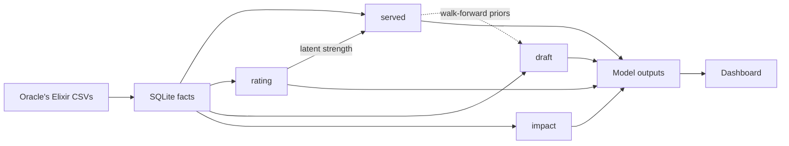

# Architecture

1. **Data**: Oracle's Elixir CSVs become facts in one SQLite database.
2. **Models**: four models fit over those facts, each one artifact family in `models/<model>/`.
3. **Outputs**: each model scores every game walk-forward into its own tables.
4. **Dashboard**: a read-only FastAPI app shows games, teams, players, drafts, and model outputs.



## The four models

| Model | Purpose | Depends on | Implementation | Lifecycle | Output tables |
| --- | --- | --- | --- | --- | --- |
| `served` | Pre-draft P(team A wins), the headline number | `rating` | `predraft/pipeline/` | `lifecycle/served.py` | `predictions` |
| `rating` | The skill filter: latent player and team strength | facts | `predraft/ratings/skill_filter/` | `lifecycle/rating.py` | `team_state`, `predictions` |
| `draft` | S to D grade and edge of a finished draft, from champions only | `served` priors | `draft_grading/` | `lifecycle/draft.py` | `draft_scores`, `pick_scores` |
| `impact` | Per-player map-win% added over a role's average premier starter | facts | `predraft/ratings/player_impact/` | `lifecycle/impact.py` | `player_impact_scores`, `impact_history` |

Paths are relative to `src/league_predictor/`. Each model's definition is one frozen
recipe object, persisted into its artifact; `src/league_predictor/index.md` names each
recipe's file. `draft_grading/DRAFT-MODEL.md` explains what the draft model means.

**Post-draft is a derived output, not a fifth model.** `postdraft/` stacks the served
prior with the draft grade into one `p_blue` (`postdraft_scores`):
`logit_final = a*l_served + (beta + u_blue + u_red)*l_draft`, fit on the games both parents
scored walk-forward. The per-team draft-utilization term `u` shrinks toward zero. Served
and draft rebuild it whenever they write their outputs.

## Lifecycle

`lifecycle/base.py` gives every model two verbs; each model's math sits behind hooks in
`lifecycle/<model>.py`.

- **`retrain`** fits the recipe on every game before the latest played day, swaps the new
  artifact family into `models/<model>/`, and rewrites the model's outputs, including its
  walk-forward history. A failure restores the previous artifact and rolls back the
  database.
- **`backfill`** scores every game with the current artifact. Served and draft also write
  their walk-forward history (monthly refits, about 30 minutes) when the database has none
  for that artifact yet: a fresh database or a newly pulled model.

Model ids are content hashes of the artifact files (`artifacts.py`), so every output row
names the exact bytes that produced it. A write replaces the model's rows and prunes rows
of earlier ids.

## Commands

```
lol-predict update      ingest new games -> backfill rating, served, draft, impact -> rebuild marts
lol-predict retrain     ingest new games -> retrain the chosen models in that order -> rebuild marts
lol-predict dashboard   serve the read-only API and UI
lol-predict upcoming    fetch the PandaScore schedule -> predict unstarted matches
```

`update.bat`, `retrain.bat`, and `dashboard.bat` at the repo root run these. Retraining
`rating` also retrains `served`, which pins the exact rating artifact it was fit on.

## Naming

`rating` is the model token for the **skill filter**, which emits **latent strength**.
Analytics separately builds **player performance profiles**, an unanchored **team strength
display** for historical games, and a region-anchored **team power display** for current
rankings. These names are not interchangeable.

The **region rating** (`predraft/ratings/region_rating/`) is the one league-strength
derivation. It anchors the team power display, prices Impact's player levels, and supplies
the served model's cross-region residual. It is a cached computation, not a model.

`impact` shows in the dashboard as **Impact Rating**. The **war room** is the draft-board
page, unrelated to Impact. `served` is the model; `predraft/` is the package implementing
it, named for when it predicts.

**"snapshot" has three meanings**, told apart by path: per-team model inputs
(`predraft/features/snapshots/`), dashboard mart rows (`analytics/team_snapshot.py`,
`analytics/player_snapshot.py`), and the skill filter's end-of-day states
(`predraft/ratings/skill_filter/state_export.py`, `index_snapshot.py`).

## Persistent state

| Location | Contents |
| --- | --- |
| `data/league_predictor.db` | Facts, model outputs, dashboard marts |
| `data/cache/` | Feature and corpus caches keyed by the facts they were built from |
| `data/power_curves.db` | The champion power grid the draft fit reads |
| `models/<model>/` | The current artifact family of each model |
