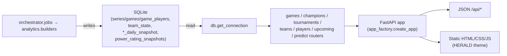

# Dashboard architecture

Implementation map of `src/league_predictor/dashboard/`, the HERALD app. System view:
`../../../architecture.md`.

HERALD is a read-only FastAPI app. It reads the rebuilt facts, the analytics marts, and
these model outputs: `predictions`, `draft_scores`, `pick_scores`, `player_impact_scores`,
`postdraft_stack`, `postdraft_scores`, and `team_state`. Every `draft_scores` read takes its
one row per (game, model) through `db/draft_scores_read.py`.

**The app performs no writes.** The `analytics/` domain writes the marts through
`refresh_analytics_marts` in `analytics/builders.py`. `orchestrator.jobs` runs it as the
tail step of `update` and `retrain`. The API
serves only the bundled UI, so fields and mart columns exist for page consumers, with no
external API contract.

Live handles key their indexes on artifact mtime and the transactional facts generation.
A committed ingest or history correction re-arms them on their next request.



## Package layout

```
dashboard/
├── __init__.py          # re-exports create_app, the one public entry
├── app_factory.py       # assembles routers, lifespan, static, and the root redirect
├── common.py            # shared SQL helpers and filter parsing
├── game_rows.py         # shared games-page SQL and GamePage pagination
├── model_serving.py     # live model handles: ServedOracle builds its index once on a
│                        #   background thread. DraftScorer wraps draft_grading/suggest.py's
│                        #   DraftSuggestEngine, which owns role assignment, legality pools,
│                        #   and rollout search. DraftScorer owns artifact and facts reload,
│                        #   the sqlite connection, and the serialization lock.
├── routes/              # one module per API area; the Routing table maps paths to modules
└── static/              # one html+js pair per page; herald.js (shell), style.css
```

## Routing

`app_factory.create_app(db_path, *, on_startup, on_shutdown)` is the only way to build the
app. It builds each router through its module's `build_*_router(db_path) -> APIRouter`
factory, which holds the db path in a closure, not a global. Each handler opens its own
connection, with no pool: `conn = get_connection(db_path); try: ... finally:
conn.close()`. `league_predictor.db.get_connection` sets WAL, foreign keys on,
busy_timeout, and the Row factory, so pragma policy has one home. Every endpoint is an open
read with no auth.

| Method | Path | Source | Purpose |
| --- | --- | --- | --- |
| GET | `/` | `app_factory.py` | redirect to `/games` |
| GET | `/games` … `/draft` | `routes/static.py` | page HTML shells |
| GET | `/static/*` | StaticFiles mount | bundled JS and CSS |
| GET | `/api/games` | `routes/games.py` | paginated match browser: as-of team strength, pre-draft prediction, draft grades, picks. `pred_source` is `'walk'` for an OOS corpus row, or `'live'` for a current-model backfill row past the corpus edge; both are leak-free. Older games without an OOS row stay null |
| GET | `/api/games/{game_id}` | `routes/games.py` → `routes/game_detail.py` | full game sheet from `build_game_detail` |
| GET | `/api/teams` | `routes/teams.py` | rankings of teams with a game within `TEAM_ACTIVITY_WINDOW_DAYS` of the snapshot date, whatever the browsed range, so dead sponsor-era ids never rank. Major-only by default, league-scoped |
| GET | `/api/teams/{id}/overview` | `routes/teams.py` | power, form, macro, and composite blocks, plus `draft_utilization`: `beta + u` and its OOS game count from `postdraft_stack`, null for a team the stack fit never saw |
| GET | `/api/teams/{id}/rating-history` | `routes/teams.py` | team-power trace under the persisted route name |
| GET | `/api/teams/{id}/roster` | `routes/teams.py` | roster with each player's as-of Impact and grade, bound to the same `end_date` as `/api/players`, so every surface shows one Impact per (player, date) |
| GET | `/api/teams/{id}/matches` | `routes/teams.py` | the team's games, through `game_rows.fetch_games_page` |
| GET | `/api/players` | `routes/players.py` | player table ordered by Impact, sub-threshold players last. Each row carries the whole as-of Impact block: `impact`, `stats_pp`, `results_pp`, `percentile`, `grade`. League-scoped |
| GET | `/api/players/{id}/overview` | `routes/players.py` | role-aware pillars plus the `draft_profile` radar block. `analytics.player_draft.RADAR_AXES` serves its axis keys, labels, and blend weights, so the page keeps no axis list of its own |
| GET | `/api/champions` | `routes/champions.py` | champion table with role and side filters |
| GET | `/api/champions/{champion}` | `routes/champions.py` | champion detail |
| GET | `/api/leagues` | `routes/tournaments.py` | leagues with games in range. The tournaments rail sets `major_only` for the dashboard-major set; the filter-bar dropdown always requests all |
| GET | `/api/tournaments/{league_id}` | `routes/tournaments.py` | league overview, ranking, picks and bans, matches |
| GET | `/api/upcoming` | `routes/upcoming.py` | scheduled matches from `upcoming_matches`, which `lol-predict upcoming` writes, with the served pre-match p_a. Paired rows carry their realized series result. Default window: today |
| POST | `/api/predict/{matchup,draft}` | `routes/predict.py` | live predictions. `matchup`: the served model at Bo1, Bo3, or Bo5 as of an optional date, with `status:'warming'` until the one-time index build finishes. `draft`: the draft-grader PRD over a draft that may be partial |
| POST | `/api/predict/draft/suggest` | `routes/predict.py` | the war room's engine lines: fast one-ply candidates for one side over the legal role pools, about 1 s. Flex-aware role assignment lets a candidate move a teammate's role. No end values; the page gets them from one batched rollout call |
| POST | `/api/predict/draft/suggest/rollout` | `routes/predict.py` | every candidate's `p_blue_end` in one lockstep batch over a `champions` list: each finished draft's value after the suggest engine plays out both sides' remaining picks. The panel costs about one candidate's wall time and one scorer-lock hold |

## `common.py` shared helpers

- `parse_league_csv(leagues)` is the one reader of the filter bar's leagues CSV: trim,
  drop blanks, empty means all. `parse_filters` and the `active_*_ids_sql` functions
  share it.
- `parse_filters(start_date, end_date, leagues, *, major_only)` returns a `FilterScope`,
  the shared filter contract: WHERE fragments over a `series` row. An explicit `leagues`
  CSV wins and silences `major_only`. The major lens is `DASHBOARD_MAJOR_LEAGUES`,
  domestic majors plus international events, which differs on purpose from the
  training population's `MAJOR_LEAGUES`.
- `db.names` owns team and player display names. Routes compose
  `canonical_team_name_sql` and `canonical_player_name_sql` into SELECT lists. Analytics
  uses `team_name_lookup` and `player_name_lookup`. Each read picks the newest alias by
  `rowid`. Never join an alias table: it fans rows out when an identity has several
  names.
- `latest_snapshot_date(conn, table, *, end_date=None)` is the MAX-date lookup. The
  `_ALLOWED_SNAPSHOT_TABLES` whitelist closes its dynamic SQL. Any other table raises
  `ValueError`.
- `academy_exclusion_clauses(column)` is the one home of the `NOT LIKE` academy filter over
  `ACADEMY_DISPLAY_NAME_SUFFIXES`. Every major-only list applies it.
- `active_team_ids_sql` and `active_player_ids_sql` define active as having games in the
  date range, read from the facts, not snapshot existence, so retired and benched players
  leave lists. An optional `league_ids` scopes activity to the selected leagues. It
  carries the `leagues` multiselect into `/api/teams` and `/api/players`, whose daily
  snapshots have no league. Both endpoints follow the shared contract: an explicit league
  selection wins and silences the major-only lens.
- `default_date_range()` returns `(YYYY-01-01, today)`, the one year-start anchor.

## Analytics dependency

The dashboard reads the marts and `analytics.team_strength_display` and builds neither.
Write-side structure and transaction invariants live in
`../analytics/analytics-architecture.md`.

## Static frontend (`static/`)

The frontend is hand-written vanilla JS, HTML, and CSS with no build step. The HERALD
theme, "the hextech desk", keeps design tokens in `style.css` `:root` and uses Marcellus,
Archivo, and IBM Plex Mono. UI text says teams, players, and champions, with no in-world
jargon.

- **`herald.js`** is the shell every page loads first: header, nav, and footer,
  `HERALD.ROLES`, the Ctrl-K command palette, the shared filter bar, the `HERALD.links.*`
  builders that link any name to its entity, and the shared components `matchTable`,
  `sortableTable`, `wrBar`, `splitBar`, and `champIcon`. `champIcon` draws Data Dragon
  icons, caches the version in localStorage, and falls back to a text chip. A page joins
  the nav bar only through the `NAV` array. `matchTable` renders series-grouped blocks: a header line with the
  series score, then one scoreboard row per game. `opts.perspective`, set by the team
  sheet, adds that team's per-series W/L and realized power delta.
- **Width limit**: content never grows past `--desk-max`, for 4K monitors. The match
  browser sets it narrower so team blocks stay near the prediction spine. `.date-bar`
  stacks above page content so its leagues dropdown paints over the boards.
- **`HERALD.filters`** is the one filter contract: date range, leagues multiselect fed by
  `/api/leagues` and persisted, and the major-only toggle. `filters.params()` yields the
  canonical query every list view sends.
- **Pages**: each tab is a thin `<name>.html` and `<name>.js` pair that fetches on load.
  Entity pages sync the selection into the URL (`?id=…`), so views are
  shareable.
- **Dash fallback**: every model-derived cell renders `–` on null, so an empty
  `predictions` log looks intentional, never like an error.

## Operational notes

- The dev port is 5000 (`config.DASHBOARD_DEFAULT_PORT`). JS and CSS changes need a
  server restart; the server reads them from disk.
- Routes treat the latest mart row as canonical. A failed mart rebuild shows as
  `as_of_date: null` with empty lists and a stale "as of" footer, never an exception.
- Player listings filter `display_name NOT LIKE 'oe:player:%'` to hide leaked OE ids.
