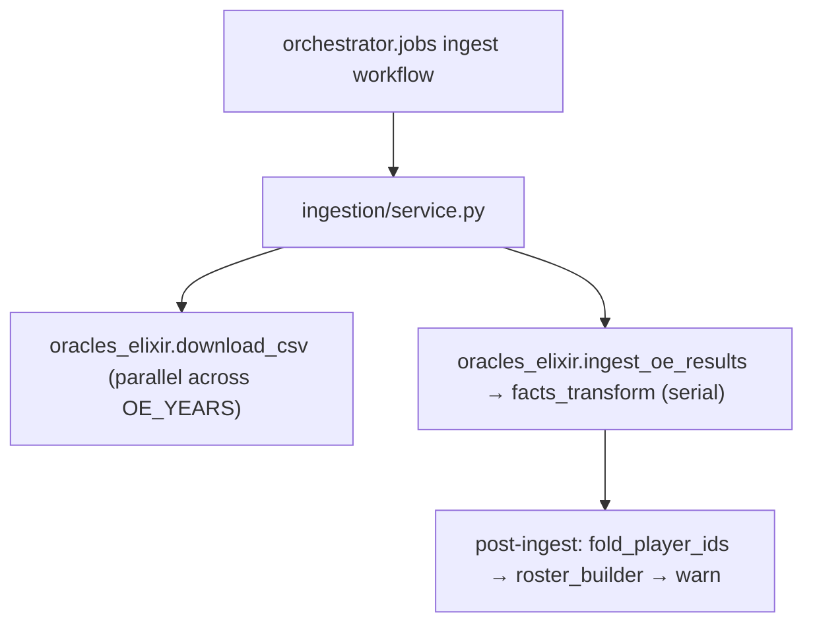

# Ingestion architecture

Ingestion adapts external sources to the SQLite DB. Each module is the only place its
vendor's wire format may appear. Data leaves in the facts row shapes: `series`, `games`,
`game_players`, `game_team_stats`, and `draft_actions`.

Ingestion stores `series.league_id` verbatim and classifies no leagues or regions. The one
league-knowledge table of tiers, region normalization, and the premier set lives in
`src/league_predictor/predraft/league_tier.py`.

`ingestion/service.py`, the `update` and `retrain` job path, is the one consumer.
It runs the Oracle's Elixir download, `ingest_oe_results`, and the post-ingest
reconciliation: `player_reconciler`, `roster_builder`, then the collision report, read from
the DB on every run. Adapters write directly, through `db.writes` when a table has other
writers.

## `oracles_elixir.py`: the OE CSV ingest

The module downloads Oracle's Elixir's per-year CSV from Google Drive with `httpx` and a
Chrome user agent, because Drive rejects a bare Python one. It ingests the CSV into the
facts tables and the `oe_team_names` and `player_aliases` lookups.

- `download_csv(year, target_dir=None)` handles Drive's confirmation pages with three
  known redirect patterns, then the canonical confirm URL, and detects the quota page
  explicitly. It streams to a `.tmp` file and raises on an HTML first chunk, so HTML never
  reaches disk. On an HTTP, OS, or parse failure it unlinks the `.tmp` and returns the
  cached `oe_{year}.csv`. **A failed download never overwrites a good cached copy**;
  quotas hit hardest on retrain days.
- `load_csv(path)` passes `pd.read_csv` a callable `usecols` over `_OE_USED_COLUMNS`. OE
  ships about 165 columns and ingestion uses about 70. The callable form halves parse time
  and memory and tolerates year-to-year column drift; older seasons lack the vision and
  @15 columns.
- `ingest_oe_results(conn, df)` routes each gameid batch through
  `facts_transform.group_series`, the one home of series identity and outcome, and writes
  the facts listed under "Tables written". It first inserts the FK dimension rows for
  `leagues`, `teams`, and `players` with `INSERT OR IGNORE`, and maps player ids through
  `player_id_map` before the facts land. Before any write, it checks every parsed row
  against its row type's required fields and raises one error naming every NULL column.
  `tests/ingestion/test_oe_real_csvs.py` ingests the real CSVs in `config.RAW_DIR`. It owns one transaction per batch: every write,
  vocabularies included, commits together at the end, and any failure rolls the batch
  back, so a partial ingest never leaks.
- `_fact_columns` derives column names and nullable casts from the DB row dataclasses. OE
  aliases stay in this module. `_col_nullable` maps NaN and absent columns to `None`. LPL
  timeline columns stay null when Oracle's Elixir does not publish them.
- Draft fields: bans and picks are length-5 lists with `None` holes, where position is
  order. `first_pick_is_blue` is `bool | None`, and an ambiguous `firstPick` yields
  `None`. Every `draft_actions` row's `seq` is a true draft slot, so ordered
  `draft_actions` are written only when the first-pick side is known, never invented. The
  unknown case's picks still survive on `game_players`.
- Lookups: `_upsert_player_aliases` writes `source='oe'` because OE is canonical for OE
  handles. Neither lookup writer commits; `ingest_oe_results` owns the one commit.

## `facts_transform.py`: the shared series transform

The transform is pure, with no DB access. Source-neutral `RawMap` rows go in; grouped
series with id maps come out. The transform:

- groups maps into series by `(unordered team pair, calendar day)`, splits at
  `game_number` resets, and sequences series within the day
- orients each series canonically, `team_a < team_b` by id, keeping blue and red as
  per-game facts
- mints the deterministic `series_id`
- derives `(best_of, winner, status)` from the realised `game_number` run through
  `infer_series_format`, the one home of the best-of rule
- reconstructs draft actions over the `vocab.draft_order` snake-draft core, shared with
  the draft grader

## `player_reconciler.py`: OE player identity

OE remints a `player_id` when a handle's casing or spacing changes. An unfolded remint
splits a player's history. **This module is the single home for player identity. No other
code may map one OE player_id to another.**

- `detect_dup_remints(conn)` finds within-game duplicates: the same
  `(game, team, role, champion)` slot under two ids is one person. Duplicates with
  conflicting champions are excluded and must stay split. The canonical id has the
  earliest first game, then more games, then the lexicographic first. The choice is
  stable because history only appends.
- `CONFIRMED_FOLDS` and `CONFIRMED_DISTINCT` hold hand-adjudicated pairs detection cannot
  see, such as id switches between vintages with no overlap. `CONFIRMED_DISTINCT` pairs
  are verified different people and are never folded.
- `known_player_map(conn)` is the stored `player_id_map` plus the curated pairs.
  `fold_player_ids` persists every pair before folding, because folding deletes the
  duplicate rows the pair was detected from. The map must outlive the evidence.
- `apply_canonical_ids(df, mapping)` folds before insert, so a republished vintage cannot
  re-split a healed history.
- `fold_player_ids(conn, mapping=None)` is the DB fold. It deletes the alias's duplicate
  rows, re-points `game_players` and `player_aliases`, and purges the alias from
  `player_daily_snapshot` and `rosters`, which the analytics rebuild and the roster builder
  re-derive. It counts and logs same-game champion conflicts and never force-resolves
  them. It is idempotent. It catches brand-new remints that the pre-insert fold, which
  knows only confirmed pairs, misses.
- `warn_unadjudicated_collisions(conn)` flags uncurated normalized handles that resolve to
  two or more playing ids: a new remint that needs adjudication.

## `roster_builder.py`: roster derivation

`build_rosters_from_player_games(conn)` derives `rosters` (in
`src/league_predictor/db/schema.py`) from the played-game facts as `(team, player, role)`
windows, half-open `[start_date, end_date)`. For each `(team, role)` seat, it orders the
game history by day, then `game_id`, with dates truncated to the day from
`series.scheduled_ts`. It splits that history into maximal single-player runs, called
stints. Each non-final stint closes at its **successor's first game date**, so a holder
stays roster-active through every date they played, including their last game. The
current stint stays open. A returning player gets a new row per stint;
`UNIQUE(team_id, player_id, role, start_date)` permits several.

The builder alone maintains the evidence-backed rows. It **reconciles** the table toward
the derived stints, so a rebuild heals windows written by earlier logic. It inserts new
stints, heals drifted `end_date`s, and prunes evidence-backed rows at an unsupported
`start_date`. Drifted windows are collapsed windows that span an absence, or departures
closed inclusively at the last game. A still-current stint keeps its `start_date`, and a
re-run on unchanged data changes nothing. Rows with no `game_players` evidence are
hand-curated, and the builder never touches them.

## Tables written

| Table | Written by | Semantics |
| --- | --- | --- |
| `series` / `games` | `ingest_oe_results` → `facts_transform` | `series_id` minted deterministically from `(day, canonical pair, seq)`; `best_of`, winner, and status from the realised `game_number` run; COALESCE-preserve upsert, so a bare re-read never wipes a recorded winner |
| `game_players` / `game_team_stats` / `draft_actions` | `ingest_oe_results` | idempotent upserts keyed to the transform's maps; team-stat rows outside the series pair dropped |
| `oe_team_names` | `upsert_oe_team_names` | `INSERT OR IGNORE` |
| `player_aliases` | `_upsert_player_aliases` | `INSERT OR REPLACE` (`source='oe'`) |

Ingestion writes only facts and lookups, never the `predictions` log. The public, no-auth
endpoints are `config.OE_GDRIVE_BASE` plus the per-year `config.OE_GDRIVE_IDS`.

## Gotchas

- **Pandas NaN is truthy**: `value or 0` silently returns NaN. Always go through
  `_col_nullable`.
- **Same-handle ids are not always the same person**: half the known collisions are
  different players. A collision warning after ingestion means a new remint needs hand
  adjudication.
