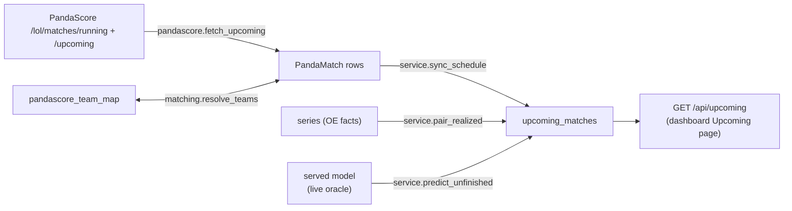

# Upcoming architecture

Implementation map of `src/league_predictor/upcoming/`: the PandaScore schedule, pre-match
and in-series predictions, and pairing with ingested series. System view:
`../../../architecture.md`.

`lol-predict upcoming` runs `orchestrator.jobs.sync_upcoming` once a day, and again during a
series to re-price it from its score:

```
fetch PandaScore feeds -> sync schedule -> pair realized series -> predict unfinished
```



## Module map

| Module | Role |
| --- | --- |
| `pandascore.py` | The one PandaScore client: pages the running and upcoming feeds into `PandaMatch`, taking each team's maps won from the match's finished games |
| `matching.py` | Canonical identity for PandaScore: teams through `pandascore_team_map`, leagues through `PANDASCORE_LEAGUE_TO_OE` |
| `service.py` | The verbs: `sync_schedule`, `pair_realized`, `predict_unfinished`, `live_served_predictor` |

## Data contract

Only this package writes its two tables in `db/schema.py`.

- **`upcoming_matches`** holds one row per PandaScore match:
  - schedule facts, including `stage`, the tournament name such as "Playoffs"
  - canonical `team_a < team_b` ids beside the PandaScore display names, NULL until matched
  - `score_a` and `score_b`, the feed's finished maps per side, NULL until matched
  - the served prediction: `p_a_map` is the next map's P(team_a), `p_a` is the series from
    the current score, plus `model_id` and `predicted_at`
  - `series_id`, once the played series is ingested

  A served query with no context of its own reads the matchup's format, stage, and score
  from this row through `predraft/features/families/original.py`. A scheduled playoff match
  then prices as a playoff, and a running series at its state.
- **`pandascore_team_map`** maps each PandaScore team to `teams.team_id`. PandaScore ids are
  stable, so each team is matched once.

**`upcoming_matches` stays outside the `predictions` table.** A model write replaces a
context wholesale and prunes earlier ids, which would erase ex-ante history. Once a match is played
and ingested, the served OOS path owns its canonical prediction. `series_id` pairing is for
display only.

## Behavior rules

- **Freeze policy.** Every run re-predicts matched unstarted matches, and running matches
  from their score. The query is the current instant, with the row's format, stage, and maps
  won as its `MatchContext`. A row freezes once its series is decided or paired to an
  ingested series. A score at the format's map-win threshold reads as `finished`, whatever
  the feed says.
- **Team matching is exact or manual.** Auto-match accepts only a normalized-name hit on
  exactly one OE team. A miss or ambiguity records an `unmatched` map row, retried each run,
  so a newly ingested OE team resolves it. The CLI summary lists unmatched teams, and
  `lol-predict upcoming-map-team <ps_team_id> <team_id>` maps one by hand. No fuzzy matching:
  predicting the wrong team is worse than no prediction.
- **Matchup changes void predictions.** A reschedule that swaps opponents or fills a TBD slot
  NULLs the stored prediction and `series_id` until the next run.
- **Feed drop is cancel, inside the horizon only.** An unstarted row that leaves the feed
  between one hour and 14 days out is marked `canceled`. Beyond the fetch horizon, absence
  means unfetched.
- **Pairing.** Same canonical team pair, nearest `scheduled_ts` within 1.5 days either way,
  each series consumed once.
- **Cost.** Fetching takes a few requests, and the free plan allows 1000 per hour. Scoring
  loads the served live oracle, MINUTES of CPU, and is skipped when nothing needs scoring.

## Settings

`config.PANDASCORE_TOKEN` reads the `PANDA` env var. `config.py` loads `panda.env` at the
project root after `.env`.

## Consumers

`dashboard/routes/upcoming.py` serves `GET /api/upcoming` from `upcoming_matches` under the
shared filter contract, for the Upcoming page in `static/upcoming.html` and `upcoming.js`.
A running row shows `LIVE a–b` and its next-map bar.
